# RAGelit

A multi-tenant document assistant with permission-aware hybrid search and
automated access-control auditing.

[](https://github.com/HuzaifaAbdulRehman/ragelit/actions/workflows/ci.yml)
[Preview release](https://github.com/HuzaifaAbdulRehman/ragelit/releases/tag/v0.1.0-preview.2)

Upload documents, assign reading access, and ask questions with source citations.
RAGelit filters evidence by organization and document grants before retrieval.
Synthetic audits help inspect where unauthorized evidence is blocked or exposed.

MVP preview for local evaluation with synthetic data. Container-security findings
and full real-model evaluations remain open. Not cleared for production or
confidential documents.

[Quick start](#quick-start) · [Screenshots](#portal) ·
[How it works](#how-it-works) · [Verification](#verification-and-measured-limits) ·
[Operator reference](OPERATIONS.md)

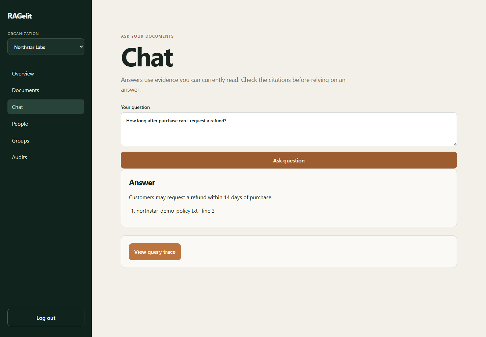

A real answer from GPT-OSS 20B hosted on Groq, citing a permitted document.
This is a small synthetic-data demonstration, not an answer-quality benchmark.

## What it does

- Separate organizations with owner, admin, member and auditor roles.
- Ingest TXT, Markdown, DOCX and text-based PDF files, with versioning and retries.
- Restrict new documents; grant reading access to people, groups or an organization.
- Combine local dense embeddings with BM25 keyword retrieval.
- Return cited answers, abstain without evidence, and expose scoped query traces.
- Run synthetic audits and export redacted JSON or offline HTML evidence.
- Compare isolation strategies and replay utility, security and cost measurements from a CLI.

Management roles do not grant document reading. Even an owner needs an explicit
reading grant for a restricted document. Tenant and grant filters apply before
search, followed by application authorization checks.

## Portal

Captured with Playwright from the running app at a 1440 × 1000 desktop viewport.
All accounts and documents are invented. These captures use the real API,
PostgreSQL, Qdrant and ingestion worker, with local BGE/BM25 embeddings and live
Groq generation for the cited answer. No mocked API responses or generated
mockups are shown.

| Organization login | Workspace overview |
| :--- | :--- |
| 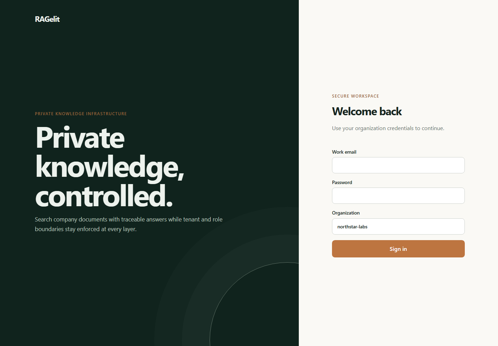 | 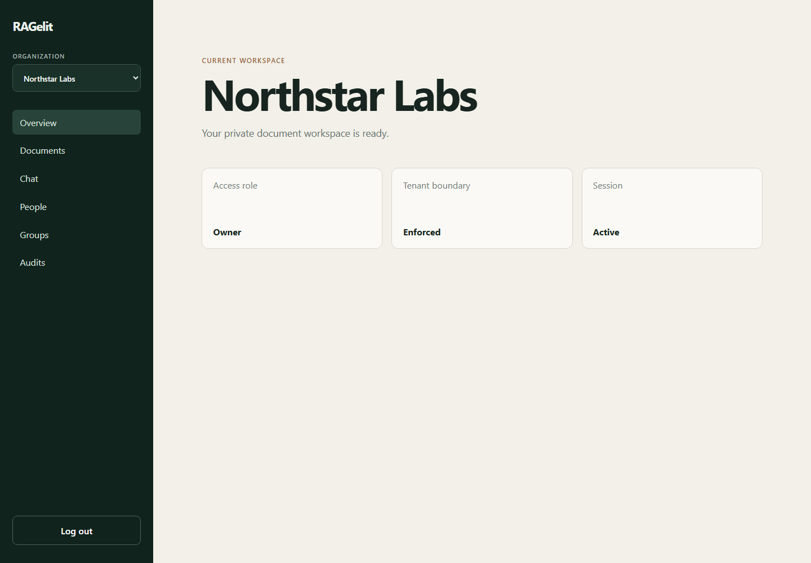 |
| Sign in to a specific organization. | See the current workspace and management role. |

Expand the sections below to see all 10 screenshots.

<details>
<summary>Documents and reading permissions</summary>

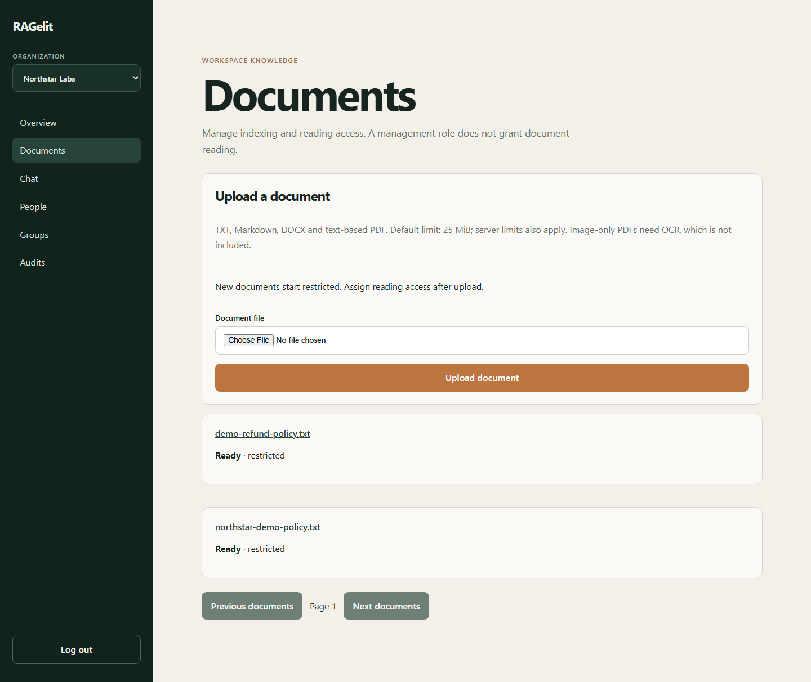

Uploads become Ready after the ingestion worker indexes them. Reading access
remains restricted until granted.

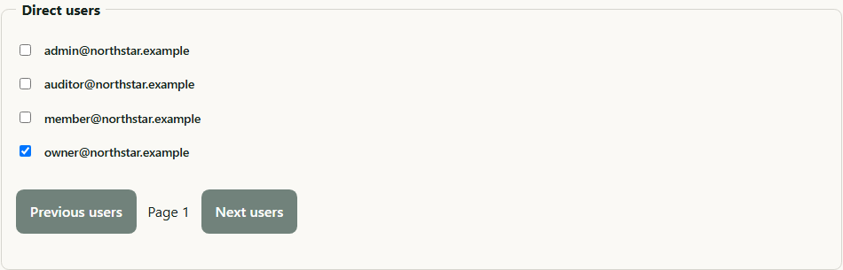

This focused view shows the owner's saved direct-user grant, not implicit access
through the owner role. The member has no reading grant.

</details>

<details>
<summary>Membership and group administration</summary>

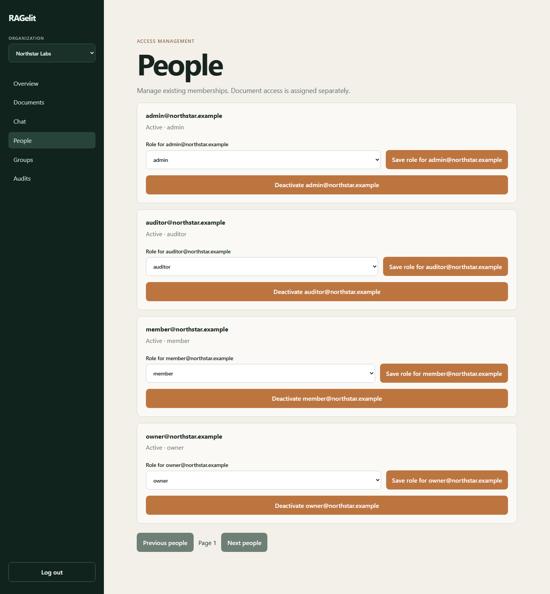

Roles control management actions; document grants are separate.

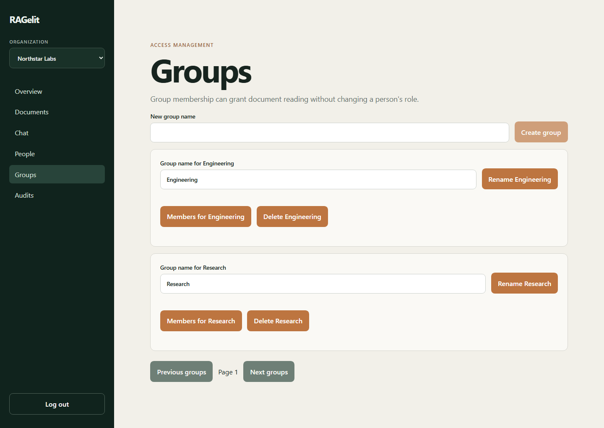

Groups can grant document reading without changing a person's role.

</details>

<details>
<summary>No-access answers and query traces</summary>

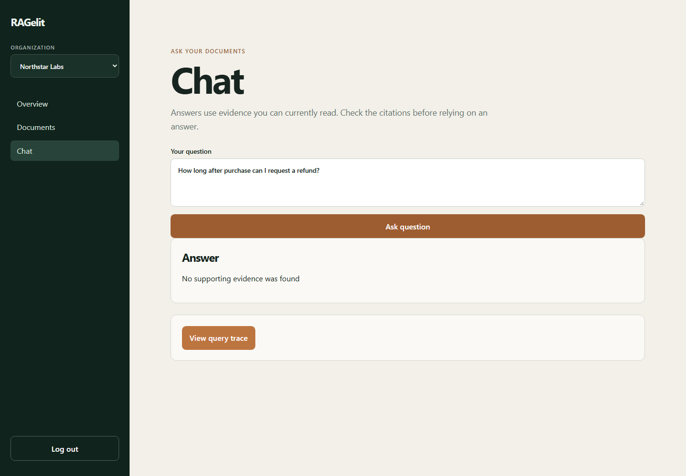

The same refund question produces no supporting evidence for a member without
reading access.

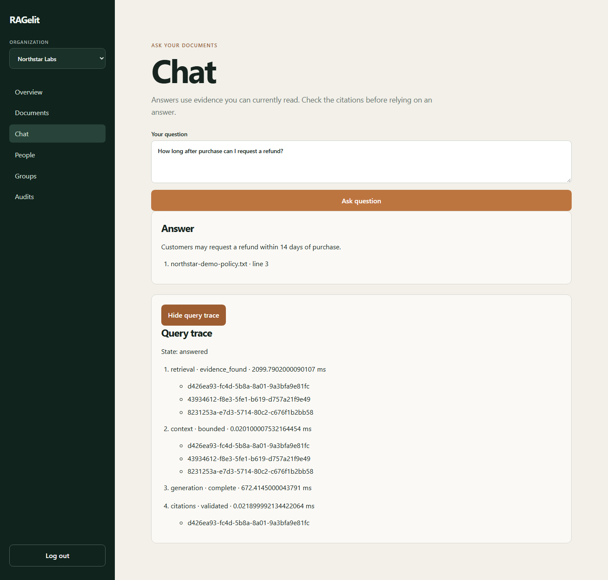

Query traces show stage decisions, timings and scoped chunk IDs. They are not
the model's internal reasoning.

</details>

<details>
<summary>Synthetic audit workspace</summary>

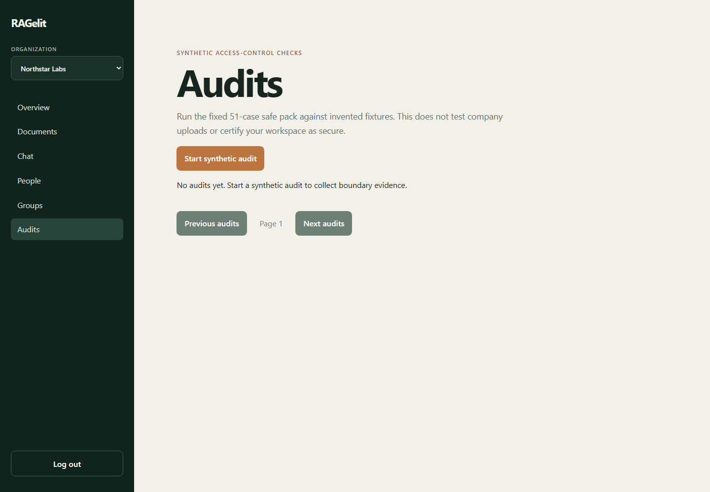

This is the audit page's empty state, not a passing result. The operator runs
the audit worker separately; queued jobs remain unknown until evidence is saved.
The fixed safe pack uses 51 invented cases, not uploaded company documents.

</details>

## How it works

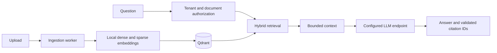

PostgreSQL stores identities, grants, document versions, jobs and query traces,
with row-level security on tenant data. Workers handle ingestion and audits
outside the web process. The lab-only retrieve-then-filter baseline is guarded
from ordinary production configuration.

The backend uses Python, FastAPI, SQLAlchemy, PostgreSQL, FastEmbed/ONNX and
Qdrant. The frontend uses React, TypeScript, TanStack Query/Router and Vite.
Dense retrieval uses BGE-small-en-v1.5; sparse retrieval uses Qdrant BM25.
Generation accepts a configured chat-completions-compatible endpoint.

## Quick start

Requires Docker Desktop/Compose, Python 3.12 or 3.13, uv, and Node.js 22 with npm.
Local embeddings run on CPU. Hosted generation does not require a local GPU.

These commands assume fresh data. The defaults use Qdrant 1.19.2 with client
1.19.1. Do not attach old database volumes directly to the new images; read
the [upgrade warning](OPERATIONS.md#existing-qdrant-data) first.

From a fresh checkout:

```powershell
git clone https://github.com/HuzaifaAbdulRehman/ragelit.git
cd ragelit
if (-not (Test-Path -LiteralPath .env)) { Copy-Item .env.example .env }
```

Edit `.env` for local configuration. Keep API keys there, never in
`.env.example` or Git. The default database passwords and signing secret are
for local development only.

Compose builds local linux/amd64 images with the pinned
[PostgreSQL zlib](docs/security/2026-10-09-postgres-zlib-candidate.md) and
[Qdrant PCRE2](docs/security/2026-10-09-qdrant-pcre2-candidate.md) fixes.
Builds need package-repository access; other container findings remain open.

```powershell
docker compose up -d --build postgres qdrant
cd backend
uv sync --frozen
uv run --frozen alembic upgrade head
uv run --frozen python -m app.seed
uv run --frozen uvicorn app.main:create_app --factory --host 127.0.0.1 --port 8000
```

Save the demo passwords printed by the first seed. Later seeds do not reset
them. On Linux/macOS, use `cp .env.example .env` only if `.env` does not exist.

In another terminal, from the repository root:

```console
cd frontend
npm ci
npm run dev
```

Open http://localhost:5173/login. Sign in with `owner@northstar.example`,
organization `northstar-labs`, and its generated password.
API docs are at http://localhost:8000/docs.

To index uploads, run a worker from `backend` with the organization UUID
returned by `GET /api/v1/organizations` after login:

```console
uv run --frozen python -m app.workers.ingestion --organization-id <organization_uuid>
```

The first ingestion run downloads the public embedding models.

### Configure answer generation

Generation is disabled until an endpoint and model are configured. A local
server or hosted provider can supply them. For example, the live screenshots
use these Groq settings in `.env`:

```dotenv
RAGELIT_LLM_BASE_URL=https://api.groq.com/openai/v1
RAGELIT_LLM_MODEL=openai/gpt-oss-20b
RAGELIT_LLM_API_KEY=replace_with_your_own_groq_key
```

Restart the API after changing settings. A hosted endpoint receives the question
and permitted document excerpts. Use synthetic data for this preview and check
your provider's usage limits. No provider credentials are discovered automatically.
See [generation setup and recovery](OPERATIONS.md#upload-and-ask-through-the-api).

## Try the document workflow

1. Upload a supported document and wait for Ready.
2. Open Edit access and grant reading to a person, group or the organization.
3. Sign in as an authorized reader, ask a question, and inspect its citations.
4. Remove access and ask a new question. Previous answers are not retroactively erased.

Audits use invented fixtures. Positive controls prevent a deny-all system from
earning a pass. CLI exit codes are `0` for pass, `1` for completed control failures
and `2` for incomplete evidence or runtime failure. Follow the
[audit commands](OPERATIONS.md#synthetic-access-control-cli) for safe and
deliberately vulnerable lab profiles.

## Verification and measured limits

The [merged-main CI run](https://github.com/HuzaifaAbdulRehman/ragelit/actions/runs/37999836956)
passed at `d9c6259`. The workflow covers static checks, backend unit and
integration tests, browser journeys, locked-dependency checks and validated
audit exports.

The October 12, 2026 live smoke check verified upload, real-model answer generation
with a matching citation, and no-access abstention using synthetic documents.
It used GPT-OSS 20B on Groq. This small check does not establish general answer
quality, prompt-injection resistance or measured revocation delay.

The [verification checkpoint](docs/verification/2026-10-07-local-release-checkpoint.md)
records the deterministic access-control, injection and isolation packs, with
offline report validation. Those checks test application behavior and the audit
harness, not real-model injection resistance.

The earlier 87-query CPU baseline completed retrieval, but all generation requests
timed out at the unchanged deadline. Full answer/citation quality and revocation
measurements remain open in [#23](https://github.com/HuzaifaAbdulRehman/ragelit/issues/23).
Unresolved container-security findings and stable-release sign-off remain in
[#24](https://github.com/HuzaifaAbdulRehman/ragelit/issues/24).

To run local verification, use `powershell -File scripts/verify.ps1` on Windows
or `bash scripts/verify.sh` on Linux/macOS. Read the
[test setup](OPERATIONS.md#verify) first: browser fixtures recreate the dedicated
`ragelit_e2e` database and collection. Use disposable test services.

No OCR, live token streaming, billing, invitations or retention purge is included.
Deletion stops retrieval but retains source files and inactive vectors. Citation
ID validation does not prove every generated claim is correct.

## Reference and support

- [Detailed local operations](OPERATIONS.md)
- [Security control matrix](docs/security/control-matrix.md)
- [Metric definitions and artifact format](docs/evaluation/metric-definitions.md)
- [Pinned embedding assets](docs/evaluation/model-pins.md) and [local generation baseline](docs/evaluation/generation-pins.md)
- [OpenAPI contract](backend/openapi.json)
- [Third-party sources and notices](THIRD_PARTY_NOTICES.md)

For bugs, use [GitHub issues](https://github.com/HuzaifaAbdulRehman/ragelit/issues)
with reproduction steps and synthetic examples. Do not attach API keys,
credentials or confidential documents.
